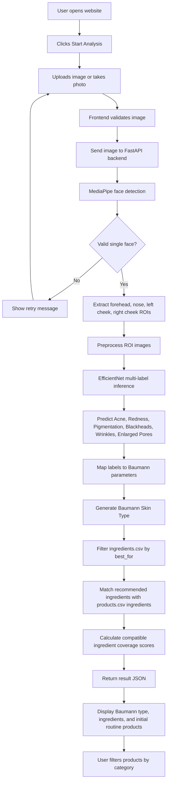
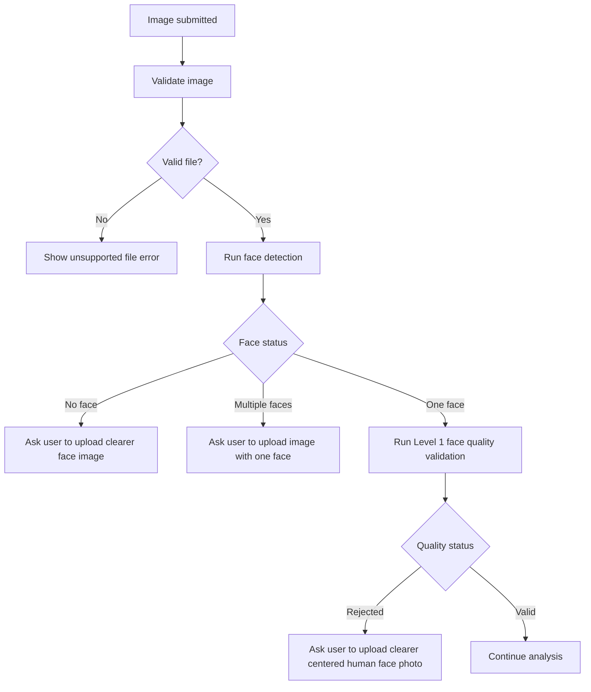
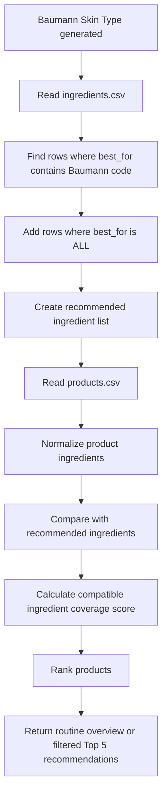
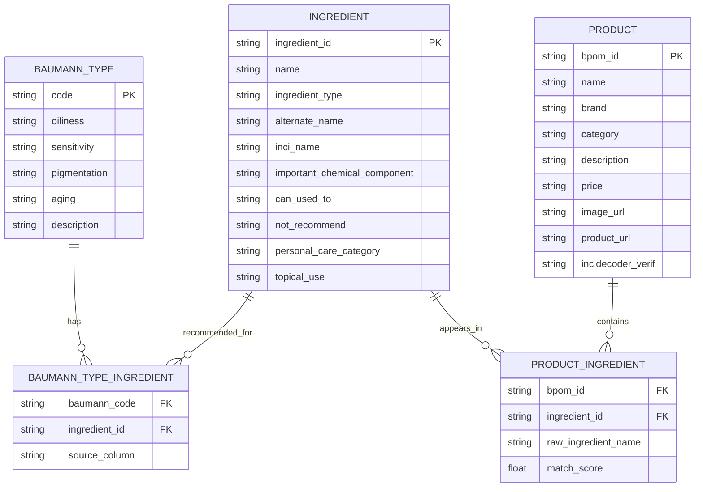
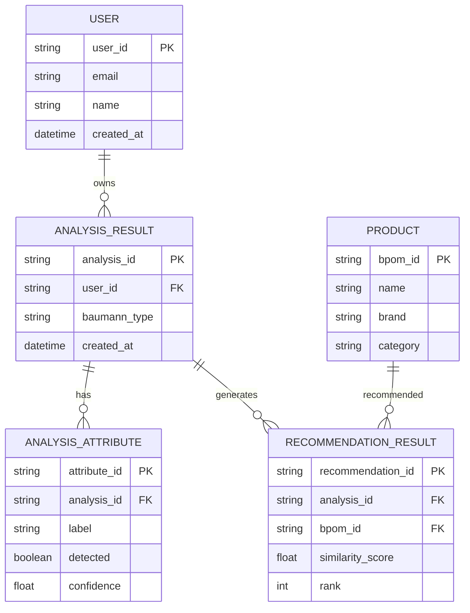

# PRD: Skin Analyzer Website

## 1. Overview

### Product Summary
The Skin Analyzer Website is a web application that analyzes a user's facial image, classifies visible skin attributes using a PyTorch EfficientNet multi-label model, maps the results into one of the 16 Baumann Skin Types, recommends suitable skincare ingredients, and ranks skincare products from the available product dataset.

### Project Goal
Help users understand their likely Baumann Skin Type and receive ingredient and product recommendations based on a structured computer vision, machine learning, and recommendation workflow.

### Current Dataset Context
This PRD is revised based on the provided datasets:

#### `ingredients.csv`
- Total rows: **73 ingredients**
- Key columns:
  - `name`
  - `ingredient_type`
  - `alternate_name`
  - `inci_name`
  - `important_chemical_component`
  - `best_for`
  - `can_used_to`
  - `not_recommend`
  - `personal_care_category`
  - `topical_use`
- The `best_for` column already maps ingredients to Baumann Skin Type codes such as `DSPT`, `DRNW`, `OSPW`, and others.
- Some rows use `ALL`, meaning the ingredient can be treated as generally suitable across Baumann types.
- The file currently has one unnamed trailing column that should be removed or ignored during data loading.

#### `products.csv`
- Product count and category values are read from the current CSV dataset.
- Key columns:
  - `bpom_id`
  - `name`
  - `brand`
  - `category`
  - `description`
  - `price`
  - `ingredients`
  - `image_url`
  - `product_url`
  - `incidecoder_verif`
- Product filters must be derived from the categories available in the loaded dataset.
- The `incidecoder_verif` column is mostly empty and should not be required for MVP recommendation logic.

### Main Output
The system should return:
- Baumann Skin Type result, for example `DSPT`
- Explanation of each Baumann parameter
- Detected ML labels and confidence scores
- Recommended ingredients from `ingredients.csv`
- An initial routine recommendation with the top matching Cleanser, Treatment, Moisturizer, and Sunscreen product from `products.csv`
- Product filtering by product main category and subcategory

### Non-Goal
The system must not present results as a medical diagnosis. It should be positioned as a skincare recommendation and educational tool.

---

## 2. Requirements

### Functional Requirements

#### Image Input
- Users can upload a facial image.
- Users can optionally take a photo using their device camera.
- The system validates image type and file size.
- Supported formats should include `jpg`, `jpeg`, `png`, and `webp`.

#### Face Detection
- The system uses MediaPipe to detect a face in the uploaded image.
- If no face is detected, the user receives a retry message.
- If multiple faces are detected, the user is asked to upload a photo with only one face.
- If exactly one face is detected, the system runs Level 1 face quality validation before ROI extraction.

#### Level 1 Face Quality Validation
The system applies a lightweight validation layer after MediaPipe detection and before ROI extraction.

This validation rejects images that are unsuitable for analysis, including:
- incomplete face landmarks
- face bounding boxes that are too small, too large, or implausibly shaped
- too many landmarks outside the image boundary
- face crops that are too dark, too bright, too flat, or too blurry
- ROI crops that are too flat or unclear for model inference

If validation fails, the backend returns `face_quality_rejected` and asks the user to upload a clearer, centered, front-facing human face photo.

This Level 1 validation is a face-quality and plausibility gate. It does not guarantee that the detected face is a real human face. Face-like dolls, masks, statues, cartoons, printed photos, or screen photos may still pass if MediaPipe detects landmarks and the image satisfies the quality heuristics. Strict human-only validation requires a separate human-vs-non-human or anti-spoofing model.

#### ROI Extraction
The system extracts four facial Regions of Interest:
- Forehead
- Nose
- Left cheek
- Right cheek

Each ROI image is cropped, resized, normalized, and prepared for model inference.

#### Skin Attribute Classification
The system uses a PyTorch EfficientNet model for multi-label classification.

Model labels:
- `Acne`
- `Redness`
- `Pigmentation`
- `Blackheads`
- `Wrinkles`
- `Enlarged Pores`

The backend should return both binary predictions and confidence scores.

#### Baumann Skin Type Mapping
The predicted labels are mapped into Baumann parameters:

| ML Output | Baumann Dimension | Positive Result | Negative Result |
|---|---|---|---|
| Blackheads or Enlarged Pores | Oily vs Dry | `O` | `D` |
| Acne or Redness | Sensitive vs Resistant | `S` | `R` |
| Pigmentation | Pigmented vs Non-pigmented | `P` | `N` |
| Wrinkles | Wrinkled vs Tight/Firm | `W` | `T` |

Example:

If the model detects:
- Blackheads = false and Enlarged Pores = false
- Acne = true or Redness = true
- Pigmentation = true
- Wrinkles = false

Then the final Baumann type is:

```txt
DSPT
```

#### Ingredient Recommendation
- The system reads `ingredients.csv`.
- The system filters rows where `best_for` contains the user's Baumann code.
- Rows with `best_for = ALL` may be included as general-purpose supporting ingredients.
- The system returns ingredient names and useful metadata such as:
  - ingredient type
  - alternate name
  - INCI name
  - suitable skin concerns from `can_used_to`
  - caution or exclusion from `not_recommend`
  - topical use explanation

#### Product Recommendation
- The system reads `products.csv`.
- The system compares recommended ingredients against each product's `ingredients` field.
- The system matches products only against the `INCI_NAME` values of compatible ingredient records.
- The system calculates an ingredient coverage score: matched compatible ingredient records divided by total compatible ingredient records for the Baumann type.
- A recommended product does not need to contain every compatible ingredient; requiring full coverage would exclude valid products from the current catalog.
- The initial result returns one top-ranked product for each routine main category in order: Cleanser, Treatment, Moisturizer, Sunscreen.
- Selecting a main category or subcategory returns its Top 5 ranked products.
- Product recommendation output should include:
  - BPOM ID
  - product name
  - brand
  - category
  - price
  - image URL
  - product URL
  - matched ingredients
  - similarity score

#### Product Filters
For the current dataset, product filters should be:
- All
- Treatment: Toner, Essence, Face Serum, Booster, Ampoule
- Cleanser: Face Wash, Cleansing Oil, Cleansing Balm, Cleansing Cream, Cleansing Gel, Scrub And Exfoliator, Micellar Water, Peeling
- Moisturizer: Face Oil, Face Cream And Lotion, Face Mist, Face Gel
- Sunscreen: Sunscreen

Unmapped future CSV categories should remain selectable under `Other`.

### Non-Functional Requirements

#### Performance
- Dataset loading should be cached in the backend instead of reading CSV files on every request.
- The ML model should be loaded once at application startup.
- Product recommendation should be calculated quickly for a dataset of at least several hundred products.

#### Security
- Uploaded images must be validated before processing.
- The backend should reject unsupported files.
- The backend should not expose internal model paths or server paths.

#### Privacy
- User images should be processed temporarily.
- Images should not be stored permanently in the MVP.
- If image storage is introduced later, explicit user consent is required.

#### Reliability
The system should handle:
- No face detected
- Multiple faces detected
- Poor lighting
- Blurry image
- Failed ROI extraction
- Model inference failure
- Missing or malformed CSV values
- Empty recommendation result

---

## 3. Core Features

### 3.1 Landing Page
The landing page explains the product and guides the user to begin skin analysis.

Content should include:
- Product headline
- Short explanation of Baumann Skin Type
- How image analysis works
- Benefits of personalized ingredient and product recommendations
- Start Analysis call-to-action
- Medical disclaimer

### 3.2 Image Upload and Camera Capture
Users can upload an image or capture one using their camera.

Expected behavior:
- Show selected image preview.
- Allow replacing or retaking the image.
- Show image quality guidance.
- Submit image to backend for analysis.

### 3.3 Face Detection and ROI Extraction
The backend detects the face and extracts forehead, nose, left cheek, and right cheek ROIs.

Optional frontend feature:
- Show ROI preview or overlay after successful face detection.

### 3.4 ML Classification
The backend runs EfficientNet inference on the ROI images.

Output:
- Acne confidence
- Redness confidence
- Pigmentation confidence
- Blackheads confidence
- Wrinkles confidence
- Enlarged Pores confidence
- Binary prediction for each label

### 3.5 Baumann Skin Type Result
The result page displays the final Baumann code and explanation.

Example:

| Letter | Meaning |
|---|---|
| D | Dry |
| S | Sensitive |
| P | Pigmented |
| T | Tight/Firm |

### 3.6 Ingredient Recommendation
The system displays ingredients from `ingredients.csv` where the `best_for` column matches the user's Baumann type.

Recommended ingredient card fields:
- Name
- Ingredient type
- INCI name
- Best for
- Can be used to address
- Not recommended for
- Topical use

### 3.7 Product Recommendation
The system recommends products from `products.csv` based on matched ingredients.

Recommendation rules:
- Only normalized `INCI_NAME` values from compatible ingredient records determine product matches.
- Each compatible ingredient record contributes at most one match, even if several of its INCI variants occur in the product.
- The score represents coverage of compatible ingredients, not a requirement for one product to contain all suitable ingredients.
- A product with partial coverage may be recommended when it ranks highest within the active product scope.
- The initial result is a routine overview: one top-ranked product each for Cleanser, Treatment, Moisturizer, and Sunscreen.
- Category browsing returns Top 5 results within the selected main category or subcategory.

Recommended product card fields:
- Product image
- Product name
- Brand
- Category
- BPOM ID
- Matched ingredients
- Similarity score
- Product link

Product descriptions and prices may remain available in the API/catalog data but are not displayed in recommendation cards.

### 3.8 Product Category Filter
The result page allows users to filter recommendations by:
- All
- Treatment
- Cleanser
- Moisturizer
- Sunscreen

Treatment, Cleanser, and Moisturizer expose their available subcategories. Sunscreen is a main-only filter in the result UI.

### 3.9 Recommendation Transparency
Each product recommendation should explain why it was recommended by showing:
- matched beneficial ingredients
- similarity score
- product category

When the recommended ingredient list includes `Retinol` or `Hydroquinone`, the result page should display a pregnancy caution directly below the ingredient list advising pregnant users to avoid products containing the displayed caution ingredients and consult a qualified clinician.

---

## 4. User Flow

### Main User Flow



### Error Flow



### Recommendation Flow



---

## 5. Architecture

### Technology Stack

| Layer | Technology |
|---|---|
| Frontend | React, Next.js |
| Backend | FastAPI |
| Backend Runtime | Python 3.12 |
| ML Framework | PyTorch |
| Face Detection | MediaPipe |
| Model Architecture | EfficientNet |
| Recommendation Logic | Python INCI matching / compatible ingredient coverage |
| MVP Dataset Storage | CSV files |
| Future Dataset Storage | PostgreSQL |

### High-Level Architecture

```mermaid
flowchart LR
    U[User] --> FE[Next.js Frontend]
    FE --> API[FastAPI Backend]
    API --> IMG[Image Validation]
    IMG --> MP[MediaPipe Face Detection]
    MP --> ROI[ROI Extraction]
    ROI --> MODEL[PyTorch EfficientNet Model]
    MODEL --> MAP[Baumann Mapping Service]
    MAP --> ING[Ingredient Recommendation Service]
    ING --> PROD[Product Recommendation Service]
    PROD --> CSV[(ingredients.csv and products.csv)]
    API --> FE
    FE --> U
```



### Backend Modules

```txt
backend/
  app/
    main.py
    api/
      routes/
        analyze.py
        ingredients.py
        products.py
    services/
      image_validation_service.py
      face_detection_service.py
      face_quality_service.py
      roi_service.py
      inference_service.py
      baumann_service.py
      ingredient_service.py
      product_recommendation_service.py
    ml/
      model_loader.py
      transforms.py
    data/
      ingredients.csv
      products.csv
    schemas/
      analysis_schema.py
      recommendation_schema.py
    utils/
      ingredient_normalizer.py
      csv_loader.py
```

### Frontend Modules

```txt
frontend/
  app/
    page.tsx
    analyze/
      page.tsx
    result/
      page.tsx
  components/
    upload/
    camera/
    result/
    ingredients/
    products/
    ui/
  lib/
    api.ts
    types.ts
    constants.ts
```

### API Endpoint Proposal

#### `POST /api/analyze-skin`
Receives an image and returns full skin analysis result.

Request:

```txt
multipart/form-data
image: File
```

Response example based on the current CSV structure:

```json
{
  "baumann_type": "DSPT",
  "attributes": {
    "acne": { "detected": true, "confidence": 0.74 },
    "redness": { "detected": false, "confidence": 0.31 },
    "pigmentation": { "detected": true, "confidence": 0.69 },
    "blackheads": { "detected": false, "confidence": 0.18 },
    "wrinkles": { "detected": false, "confidence": 0.22 },
    "enlarged_pores": { "detected": false, "confidence": 0.27 }
  },
  "baumann_mapping": {
    "oiliness": "Dry",
    "sensitivity": "Sensitive",
    "pigmentation": "Pigmented",
    "aging": "Tight/Firm"
  },
  "recommended_ingredients": [
    {
      "name": "Ceramides",
      "ingredient_type": "functional",
      "alternate_name": "Ceramide",
      "inci_name": "Ceramide NP, Ceramide AP, Ceramide EOP, Ceramide NS",
      "best_for": "DRNT, DRNW, DRPT, DRPW, DSNT, DSNW, DSPT, DSPW",
      "can_used_to": "sensitive, inflamed",
      "not_recommend": "none",
      "personal_care_category": "barrier repair, moisturizing",
      "topical_use": "to be able to penetrate into the skin when exogenously applied"
    },
    {
      "name": "Argan Oil",
      "ingredient_type": "plant",
      "alternate_name": "Liquid Gold of Morocco, Minyak Argan, Moroccan Oil, Argania Spinosa",
      "inci_name": "Argania Spinosa Kernel Oil, Argania Spinosa Extract",
      "best_for": "DRNW, DRPW, DSNT, DSNW, DSPT, DSPW",
      "can_used_to": "dry, sensitive",
      "not_recommend": "none",
      "personal_care_category": "antioxidant, moisturizing, anti-inflammatory",
      "topical_use": "very useful in rosacea and reduces redness"
    }
  ],
  "recommended_products": [
    {
      "bpom_id": "NA11251200510",
      "name": "5X Ceramide Low PH Cleanser",
      "brand": "Skintific",
      "category": "Face Wash",
      "mainCategory": "Cleanser",
      "subCategory": "Face Wash",
      "description": "pH balanced face cleanser suitable for sensitive skin with 5 types of Ceramides, Niacinamide, and Hyaluronic Acid.",
      "price": "45.650,00",
      "similarity_score": 0.91,
      "matched_ingredients": ["Ceramides", "Hyaluronic Acid", "Niacinamide"],
      "image_url": "https://images.soco.id/423c68b7-5de3-462b-810e-0fbcf671bd50-image-0-1766120188788",
      "product_url": "https://sociolla.com/face-wash/64150-5x-ceramide-low-ph-cleanser",
      "incidecoder_verif": null
    },
    {
      "bpom_id": "NA11231201019",
      "name": "Mugwort Purifying Micellar Water",
      "brand": "Skintific",
      "category": "Micellar Water",
      "mainCategory": "Cleanser",
      "subCategory": "Micellar Water",
      "description": "Micellar water with Mugwort, Centella, and Ceramide for cleansing while maintaining skin moisture.",
      "price": "69.500,00",
      "similarity_score": 0.84,
      "matched_ingredients": ["Ceramides", "Centella Asiatica"],
      "image_url": "https://images.soco.id/b98e9eb7-e5a3-437d-8fc5-746376e486b5-.jpg",
      "product_url": "https://sociolla.com/micellar-water/79043-mugwort-purifying-micellar-water",
      "incidecoder_verif": null
    }
  ],
  "productCategoryFilters": [
    {"mainCategory": "Treatment", "subCategories": ["Toner", "Essence", "Face Serum", "Booster", "Ampoule"]},
    {"mainCategory": "Cleanser", "subCategories": ["Face Wash", "Cleansing Oil", "Cleansing Balm", "Cleansing Cream", "Cleansing Gel", "Scrub And Exfoliator", "Micellar Water", "Peeling"]},
    {"mainCategory": "Moisturizer", "subCategories": ["Face Oil", "Face Cream And Lotion", "Face Mist", "Face Gel"]},
    {"mainCategory": "Sunscreen", "subCategories": ["Sunscreen"]}
  ]
}
```

#### `GET /api/products?baumannType=DSPT&mainCategory=Cleanser&subCategory=Face%20Wash`
Returns product recommendations for a Baumann type and optional main/subcategory selection. The legacy `category` query remains available as a subcategory alias during migration.

Response example:

```json
{
  "baumann_type": "DSPT",
  "mainCategory": "Cleanser",
  "subCategory": "Face Wash",
  "total_candidates": 81,
  "top_k": 5,
  "products": [
    {
      "bpom_id": "NA11251200510",
      "name": "5X Ceramide Low PH Cleanser",
      "brand": "Skintific",
      "category": "Face Wash",
      "mainCategory": "Cleanser",
      "subCategory": "Face Wash",
      "price": "45.650,00",
      "matched_ingredients": ["Ceramides", "Hyaluronic Acid", "Niacinamide"],
      "similarity_score": 0.91,
      "image_url": "https://images.soco.id/423c68b7-5de3-462b-810e-0fbcf671bd50-image-0-1766120188788",
      "product_url": "https://sociolla.com/face-wash/64150-5x-ceramide-low-ph-cleanser"
    }
  ]
}
```

#### `GET /api/ingredients?baumann_type=DSPT`
Returns ingredients suitable for a Baumann type using the `best_for` column in `ingredients.csv`.

Response example:

```json
{
  "baumann_type": "DSPT",
  "include_all": true,
  "ingredients": [
    {
      "name": "Borage Seed Oil",
      "ingredient_type": "plant",
      "best_for": "DSNT, DSPT, DSNW, DSPW",
      "can_used_to": "dry, sensitive",
      "not_recommend": "none",
      "personal_care_category": "Lipophilic, occlusive, emollient, anti-inflammatory, hydrating",
      "topical_use": "an important ingredient for dry and inflamed skin types"
    }
  ]
}
```

### Recommendation Logic

```python
def recommend_products(baumann_type, ingredients_df, products_df, category=None, top_k=5):
    suitable_ingredients = get_ingredients_by_baumann_type(
        ingredients_df=ingredients_df,
        baumann_type=baumann_type,
        include_all=True
    )

    if category and category != "All":
        products_df = products_df[products_df["category"] == category]

    results = []

    for _, product in products_df.iterrows():
        product_ingredients = normalize_ingredient_text(product["ingredients"])
        matched = match_inci_names(suitable_ingredients, product_ingredients)
        score = len(matched) / max(len(suitable_ingredients), 1)

        if score > 0:
            results.append({
                "bpom_id": product["bpom_id"],
                "name": product["name"],
                "brand": product["brand"],
                "category": product["category"],
                "price": product["price"],
                "similarity_score": score,
                "matched_ingredients": matched,
                "image_url": product["image_url"],
                "product_url": product["product_url"]
            })

    return sorted(results, key=lambda x: x["similarity_score"], reverse=True)[:top_k]
```

---

## 6. Design & Technical Constraints

### Design Constraints
- The UI should feel clean, credible, and skincare-oriented.
- The analysis process should be easy to understand for non-technical users.
- The result page should explain the Baumann type clearly.
- Product cards should prioritize clarity over visual clutter.
- Recommendations should show matched ingredients so users understand why a product appears.
- A medical disclaimer should be visible on the result page.

### Technical Constraints
- Frontend must use Next.js.
- Backend must use FastAPI.
- ML model must be developed using PyTorch.
- Face detection and ROI extraction use MediaPipe.
- Model architecture uses EfficientNet.
- MVP dataset source uses CSV files.
- Product category filters must be generated from the categories present in `products.csv`.
- The backend should cache CSV data at startup.
- The backend should normalize ingredient names before matching.
- The backend should match products using `INCI_NAME` values only and calculate compatible-ingredient coverage, not cosine similarity.
- Product recommendation does not require complete coverage of all compatible ingredients.
- Price values should be parsed carefully because the current dataset uses Indonesian-style formatting, for example `45.650,00`.
- Product category naming should be standardized in the UI; the canonical display name for sun-protection products is `Sunscreen`.

### CSV vs Database Decision
For the MVP, use CSV because:
- The current dataset is small enough: 73 ingredients and 187 products.
- The data appears mostly static.
- There is no stated admin dashboard requirement yet.
- There is no stated user history requirement yet.
- CSV keeps development faster while the ML and recommendation workflow is still being validated.

Move to PostgreSQL later when:
- Product data grows significantly.
- Products or ingredients need frequent updates.
- Admin CRUD features are required.
- User accounts or analysis history are added.
- Analytics, click tracking, favorites, or feedback are added.
- More advanced querying and indexing are needed.

### Dataset Cleaning Constraints
Before production use, clean or standardize:
- Remove unnamed empty column from `ingredients.csv`.
- Standardize Baumann codes in `best_for`.
- Standardize ingredient casing and punctuation.
- Normalize alternate ingredient names and INCI names.
- Standardize product categories.
- Validate empty or missing image URLs.
- Decide whether `incidecoder_verif` should be removed, populated, or ignored.

---

## 7. Entity Relationship Diagram

### MVP Dataset ERD



### Optional Future ERD with User History



---

## 8. Development Phases

### Phase 1: Project Setup and Dataset Preparation

#### Goals
Create the base frontend, backend, and dataset structure.

#### Tasks
- Initialize Next.js frontend.
- Initialize FastAPI backend.
- Add `ingredients.csv` and `products.csv` to backend data folder.
- Create CSV loader utility.
- Clean unnamed column from `ingredients.csv` or ignore it during loading.
- Standardize category labels from `products.csv`.
- Define TypeScript and Python response schemas.

#### Deliverables
- Running frontend.
- Running backend.
- Clean dataset loading service.
- Initial API contract.

### Phase 2: Image Input and Face Detection

#### Goals
Allow users to submit images and validate face presence.

#### Tasks
- Build upload UI.
- Add optional camera capture.
- Implement image validation.
- Integrate MediaPipe Face Landmarker with a local `face_landmarker.task` file.
- Handle missing model, no-face, and multiple-face cases.
- Add Level 1 face quality validation for landmark completeness, face geometry, lighting, detail, and ROI clarity.

#### Deliverables
- Working image upload flow.
- Working face detection service.
- Error handling for invalid images.
- Setup script for downloading the Face Landmarker model.

### Phase 3: ROI Extraction

#### Goals
Extract forehead, nose, left cheek, and right cheek regions only after face quality validation passes.

#### Tasks
- Calculate ROI coordinates from MediaPipe landmarks.
- Crop ROI images.
- Resize and normalize ROI images.
- Add development-only debug previews for ROI crops.
- Reject extracted ROI sets when all crops are too flat or unclear for inference.

#### Deliverables
- ROI extraction module.
- Preprocessed ROI tensors for model inference.
- Tested Level 1 face quality and ROI quality rejection behavior.

### Phase 4: ML Model Integration

#### Goals
Connect EfficientNet model inference to the backend.

#### Tasks
- Load trained EfficientNet model in FastAPI.
- Apply preprocessing transforms.
- Run multi-label inference on ROI images.
- Aggregate predictions from four ROIs.
- Apply class thresholds.
- Return confidence scores.

#### Deliverables
- Working inference service.
- Predicted labels and confidence scores.

### Phase 5: Baumann Mapping

#### Goals
Convert ML labels into Baumann Skin Type.

#### Tasks
- Implement mapping rules for D/O, S/R, P/N, W/T.
- Use Blackheads or Enlarged Pores to determine Oily; otherwise use Dry.
- Use Acne or Redness to determine Sensitive.
- Use Pigmentation to determine Pigmented.
- Generate final 4-letter Baumann code.
- Add tests for all Baumann combinations.

#### Deliverables
- Baumann mapping service.
- Tested Baumann output logic.

### Phase 6: Ingredient Recommendation

#### Goals
Recommend ingredients based on `ingredients.csv`.

#### Tasks
- Parse the `best_for` column.
- Match user Baumann type against ingredient `best_for` values.
- Include `ALL` ingredients as optional general recommendations.
- Return useful ingredient metadata to frontend.

#### Deliverables
- Ingredient recommendation service.
- Ingredient recommendation API response.

### Phase 7: Product Recommendation

#### Goals
Recommend products based on ingredient matching.

#### Tasks
- Parse product `ingredients` field from `products.csv`.
- Normalize ingredient names.
- Match compatible `INCI_NAME` terms against product composition.
- Calculate compatible-ingredient coverage score.
- Rank products.
- Return one top-ranked product per main routine category for the initial result.
- Return Top 5 products within a selected main category or subcategory.
- Add category filters derived from the loaded product dataset.

#### Deliverables
- Product recommendation service.
- Top 5 recommendation output.
- Product filter support.

### Phase 8: Result Page and Deployment

#### Goals
Complete the user-facing experience and deploy the MVP.

#### Tasks
- Build result page.
- Display Baumann Skin Type explanation.
- Display detected attributes and confidence scores.
- Display recommended ingredients.
- Display Top 5 product recommendations.
- Add category filtering.
- Add disclaimer.
- Configure CORS.
- Deploy frontend and backend.

#### Deliverables
- Complete MVP user flow.
- Deployed frontend.
- Deployed backend API.
- Ready-to-test Skin Analyzer Website.
